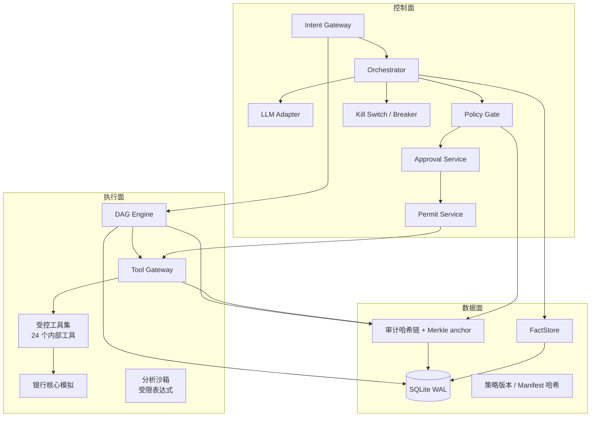

# 技术文档 · 磐石银行 AI 智能体

> 版本：v0.2（M0–M4 已实现）  
> 配套：[架构决策](spec.md) · [ADR](decisions.md) · [证据日志](research-log.md) · [安全自评](security-self-assessment.md)

---

## 1. 系统定位

磐石是一个**竞赛级银行 AI Banking Agent 原型**：用户用自然语言提出银行需求，系统完成意图理解、任务规划、权限裁决、工具执行、证据回执与审计回放。

核心不变量：

1. **模型只提议，不执行**：LLM 输出 `IntentProposal / DagProposal / ToolCallProposal / Explanation`。
2. **权限由模型之外的确定性系统裁决**：Policy Gate 输出 GREEN/YELLOW/RED/DENY。
3. **没有签名 Permit，工具网关拒绝写操作**：Permit 绑定主体、工具、参数哈希、金额、认证方式、审批人、过期时间与 nonce。
4. **工具返回默认不可信**：检测到高危指令时 `tainted=true`，写操作阻断。
5. **数字必须有证据**：回执中的每个数字必须能在本轮 FactStore 找到。
6. **副作用可补偿**：每个写操作返回签名补偿令牌，失败/取消时逆序补偿。

---

## 2. 三平面架构



- **控制面**：输入规范化、意图路由、策略裁决、审批、Permit、熔断。
- **执行面**：DAG 节点执行、工具网关、受控工具、账务模拟、分析沙箱。
- **数据面**：运行状态、冻结/账务、FactStore、append-only 审计、策略/manifest 版本。

---

## 3. 请求生命周期

```text
用户消息
  → H1 输入 Hook：NFKC、去零宽、长度限制、注入检测
  → Intent Gateway：MockLLM / OpenAI-compatible 意图解析
  → Orchestrator 路由：transfer / bill / birthday / direct
  → DAG Engine：按固定节点拓扑执行
      N0 会话绑定
      N1 意图解析（LLM 提案）
      N2 收款人解析（只读工具）
      N3 风险事实（金额、日累计、速度、taint）
      N4 Policy Gate（确定性裁决）
      N5 审批信封 + 强验证
      N6 冻结资金 / 创建定时任务
      N7 提交转账
      N8 证据锚定回执
      N9 审计锚定
  → H6 输出 Hook：数字白名单、PII 脱敏
  → Tool Gateway：验 Permit、验参数哈希、验 nonce、幂等、执行、脱敏
  → Audit：每事件哈希链接前一条；每 100 条 Merkle anchor
```

中断发生在节点边界；`run.status=awaiting_user`，状态写入 checkpoint。恢复时从当前节点继续，已完成的副作用不会重复执行（幂等键）。

---

## 4. 核心算法

### 4.1 权限裁决（Policy Gate）

输入：动作、金额、当日已用（含在途/冻结）、用户限额、账户状态、收款人风险/状态、渠道、认证等级、taint、熔断状态、velocity、是否新收款人、Mandate 覆盖。

输出：

```json
{
  "tier": "GREEN | YELLOW | RED | DENY",
  "decision": "ALLOW | CONFIRM | STRONG_AUTH | DENY",
  "required_auth": "none | user_confirm | totp | mandate",
  "reason_codes": ["TIER_YELLOW_SMALL_TRANSFER"],
  "constraints": {"max_amount_cents": 80000},
  "policy_version": "policy-2026.10.31"
}
```

关键规则：

- 纯查询 → GREEN / ALLOW。
- 日累计投影 ≤ 1000 元 → YELLOW / CONFIRM。
- 日累计投影 > 1000 元 → RED / TOTP。
- 改密、挂失/解挂、理财申购 → RED（即使金额小/可逆）。
- 黑名单/高风险收款人、账户冻结、taint 写、熔断 OPEN、超硬上限 → DENY。
- Mandate 覆盖的订单 → ALLOW（auth=`mandate`），但金额/商户类别/时间窗/剩余额度必须匹配。

### 4.2 日累计原子预占（防拆单）

`dailyUsage = 当日已提交转账 + 当日 active holds`。判定使用 `used + amount` 的投影值；冻结在 `BEGIN IMMEDIATE` 事务中创建，并发第二笔会看到第一笔的 hold，投影超限即升级 RED。两笔 800 元不会都按 YELLOW 通过。

### 4.3 Execution Permit（能力令牌）

```text
token = permit_id + "." + HMAC-SHA256(secret,
        permit_id : params_hash : expires_at)
```

Tool Gateway 校验：

1. Permit 存在、签名有效、未使用、未过期。
2. `subject` 与会话用户一致。
3. `tool` 与请求工具一致。
4. canonical params 的 SHA-256 与 Permit 的 `params_hash` 一致。
5. 金额不超过 `max_amount_cents`。
6. 原子标记 `used=1`；重放拒绝。

参数、金额、收款人任一变化都会导致哈希不匹配，审批后的篡改无法执行。

### 4.4 审批信封与 TOTP 交易挑战

信封字段：`trace_id / run_id / node_id / tool / params / params_hash / impact / reversibility / required_auth / risk_reasons / intent_summary / evidence_refs / challenge / nonce / expires_at`。

RED 使用 TOTP + `challenge = HMAC(amount|payee|memo)`，审批接口要求 challenge 与信封一致；生产应替换为 FaceID/WebAuthn。

### 4.5 DAG 与补偿

节点接口：

```js
{ id, deps, execute(ctx), rollback(ctx, result), onInterrupt(ctx, reason) }
```

- 节点边界 checkpoint（SQLite）。
- 副作用只在 Tool Gateway 发生；节点可重放。
- 网关返回签名补偿令牌（`ledger.release_hold` / `transfer.reverse` / `order.cancel` / `schedule.cancel` / `mandate.revoke`）。
- 失败/取消：逆序调用 `gateway.compensate(token)`；补偿失败标记 `NEEDS_RECONCILIATION`，不伪造成功。
- 已完成操作撤销：`engine.undo` 找到未使用、未被取代的补偿令牌，逆序执行；转账走 `transfer.reverse`，生日计划走 `order.cancel` + `release_hold` + `mandate.revoke`。
- 转账提交后，N6 的“释放冻结”补偿标记为 `superseded`，避免撤销时先释放已捕获的冻结。
- 定时任务：`scheduled_jobs` 到期由 Scheduler 创建新 run；执行时重新评估策略，不沿用创建时决策。

### 4.6 审计哈希链

每条事件：

```text
hash = SHA256(canonical({
  seq, event_id, trace_id, run_id, step_id, node_id,
  event_type, ts, payload_json, prev_hash
}))
```

存储：JSONL 追加 + SQLite `audit_events`（trigger 禁止 UPDATE/DELETE）。每 100 条计算 Merkle root 写入 `audit_anchors`。`verify` 重算链与锚点；`timeline(trace_id)` 返回可回放事件；`simulate` 可用记录事实重跑策略（扩展点）。

### 4.7 Taint 与注入防御

- 用户输入：`USER`，仍做注入检测。
- 工具返回：结构 `TOOL_VERIFIED`，内容默认 `UNTRUSTED`；网关扫描字符串，命中高危模式则 `tainted=true`。
- 写节点若使用 tainted 工具结果 → 失败 `TAINTED_TOOL_RESULT`；Policy Gate 也拒绝 `TAINTED_WRITE`。
- 工具 manifest 哈希锁定，未知工具/篡改清单拒绝。

### 4.8 幻觉防护

- FactStore 持久化每轮事实：`{type, value, source, trust, tool_call_id}`。
- 回执模板化生成，数字来自 FactStore。
- `validateNumericClaims` 提取数字/日期，逐一匹配事实值；不匹配则替换为 `SAFE_FALLBACK` 并写 `hallucination.blocked` 审计。
- 禁止用历史会话旧数字回答本轮余额；旧事实需重新查询。

### 4.9 分析沙箱

`src/sandbox/expression.js` 是受限表达式求值器：只允许数字、白名单变量、`+ - * /`、括号；限制长度 500、token 200、嵌套 24；无文件/网络/进程访问；未知标识符直接拒绝。LLM 只能提交公式，不能提交代码。核心资金链路不执行生成代码。

### 4.10 真实模型适配与确定性 grounding

- OpenAI-compatible 适配器支持自定义 `OPENAI_BASE_URL` / `OPENAI_CHAT_PATH` / `OPENAI_MODEL`；`PANSHI_LLM_STRICT=1` 时禁用 Mock 回退，评测失败可见。
- **金额 grounding**：`primaryAmountCents` 从用户原话提取主金额，覆盖模型输出的 `amount_cents`；模型算错“800 元 = 8000000 分”也不会改变实际转账金额。
- **周期 grounding**：`last month` / `2026-09` / `上个月` 等别名统一为 `last_month`，避免模型格式差异导致工具参数校验失败。
- **意图 grounding**：用户明确说“可疑/异常/重复扣款”时，将 `bill.analyze` 纠正为 `bill.anomaly`；生日计划被误判为 out_of_scope 时纠正为 `birthday.plan`。
- 这些纠正是确定性代码，不属于权限裁决；权限仍由 Policy Gate 独立裁决。

---

## 5. 数据模型（SQLite）

| 表 | 用途 |
|---|---|
| `users / accounts / payees` | 用户、账户、收款人 |
| `ledger_entries / holds / transfers` | 复式记账、冻结、转账 |
| `bills / cards / subscriptions / calendar_events / orders` | 场景数据 |
| `runs / checkpoints` | DAG 运行与断点 |
| `approvals / permits / compensations` | 审批、许可、补偿令牌 |
| `idempotency` | 网关幂等 |
| `facts` | 证据锚定 |
| `audit_events / audit_anchors` | 哈希链审计 |
| `breaker_state / breaker_counters` | 熔断 |
| `mandates / scheduled_jobs` | 消费授权、定时任务 |

---

## 6. API

| 方法 | 路径 | 用途 |
|---|---|---|
| POST | `/api/session` | 演示登录 |
| POST | `/api/chat` | 发送消息，返回 run/view/reply |
| GET | `/api/runs/:id` | 运行状态、DAG、审批、审计 |
| POST | `/api/runs/:id/resume` | 澄清/授权后恢复 |
| POST | `/api/runs/:id/approve` | 审批（approve/reject + TOTP） |
| POST | `/api/runs/:id/cancel` | 取消并补偿 |
| POST | `/api/runs/:id/undo` | 已完成操作撤销（冲正/取消订单/释放冻结） |
| GET | `/api/audit/:trace` | 审计时间线 |
| GET | `/api/audit/:trace/verify` | 哈希链校验 |
| GET | `/api/safety/summary` | 安全面板聚合 |
| POST | `/api/admin/killswitch` | 全局熔断（operator） |
| POST | `/api/demo/advance` | 时间快进并触发调度 |
| GET | `/api/tools` | 工具清单与 manifest 哈希 |

---

## 7. 评测

- `tests/`：44 个单元/集成测试。
- `adversarial_tests/run.js`：18 条攻击用例。
- `eval/run.js`：11 个用例；3 个核心场景重复 20 次；输出 `eval/report.md/json`。
- 指标：TCR、PCR、TCA、ABR、HBR、PBR、RRR、Pass^k、p95。

当前基线：44/44、18/18、3/3 pass^20、指标 100%、p95 约 150–700ms（Mock LLM，视机器负载；空载约 145ms）。

---

## 8. 生产化差距

1. 账务/清算/渠道为模拟；真实银行需核心系统适配、事务数据库、消息队列、对账。
2. TOTP 模拟生物识别；生产需 WebAuthn/FaceID 与设备绑定。
3. SQLite 单进程；生产需分布式状态、独立 WORM 审计存储、HSM/KMS。
4. 分析沙箱是表达式级，不是通用代码沙箱；不执行 LLM 生成代码。
5. 真实 LLM 需额外做供应商零数据保留、区域合规、模型版本固定与回归。
6. 风控规则需按监管与银行内控校准；当前阈值为竞赛演示值。


